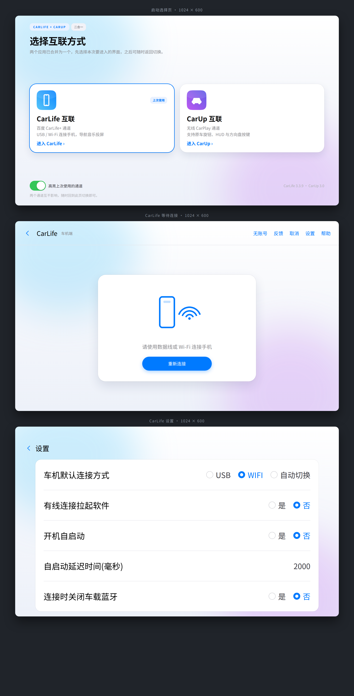

# CarLife × CarUp 二合一

把百度 CarLife（车机端）和 CarUp（无线 CarPlay 通道）合成**一个 APK**，桌面只有一个图标，启动时先选通道。包名沿用 `com.baidu.carlifevehicle`，车机白名单、自启动规则都不受影响。

界面按 iOS 风格重做：选择页、CarLife 等待连接页、设置页、标题栏、对话框、图标全部换过。

**v1.1 新增**：把 CarLife 的方控监听方式接进了 CarUp —— 见下一节。



---

## v1.1：CarUp 增加 CarLife 方控监听

### 问题

CarUp 原本只监听三条标准路径：

| 监听方式 | 说明 |
| --- | --- |
| `window` | Activity 的 `dispatchKeyEvent` |
| `media-session` | `MediaSession` 回调 |
| `media-button-receiver` | `android.intent.action.MEDIA_BUTTON` 广播 |
| `volume` | 音量变化推算出的旋钮动作 |

但一大批车机（长安、吉利、奇瑞、比亚迪部分车型、阿达优、NWD、讯飞方案…）**根本不发 Android 标准按键**，而是由 MCU 发一条**厂商私有广播**，键值还是自定义的字符串或整数。百度 CarLife 专门为这些车写了 8 个 Receiver，CarUp 没有，所以在这些车上 CarUp 的方控完全没反应 —— 方向盘按了没动静，学习页也学不到。

### 做法

新增 `CarLifeMcuKeys`（`com.shilapi.xcertplay.CarLifeMcuKeys`），在 `DualApplication.onCreate()` 里动态注册这 8 种广播，解析成 Android 标准媒体键码，再送进 CarUp 原有的处理链：

```
车机 MCU 广播
   ↓  CarLifeMcuKeys（解析 key_value / Key_code / c3_hardkey_keycode / value / CLICK_KEY）
   ↓  标准键码 87/88/85/126/127/86/89/90
   ├─ 学习页在前台 → WheelKeysActivity.logKey(source=carlife-mcu) + onKey()
   └─ 正常运行     → CarPlayMediaKeys.onWheelKey(down) → 110ms 后补一个 up
```

同时在 `WheelKeySource` 枚举里补了一项 **`CARLIFE`（label `carlife-mcu`）**，这是 CarUp 的第 6 种监听方式，日志和学习页里能直接认出按键来自车机方控广播。

### 已支持的车机广播

| 车机 / 方案 | action | 键值字段 | 按下判定 |
| --- | --- | --- | --- |
| 长安（okl） | `com.okl.android.MCU_KEY_IND_ACTION` | `key_value` | `key_state == PRESS_DOWN` |
| 长安（联友） | `com.coagent.intent.action.KEY_CHANGED` | `Key_code` | `Key_state == UP` |
| 长安 C3 / 奇瑞 | `android.intent.action.C3_HARDKEY` | `c3_hardkey_keycode` | `c3_hardkey_action == 0` |
| 吉利 | `com.spd.system.key` | `value` | `state == 1` |
| 阿达优 | `com.adayo.android.MCU_KEY_IND_ACTION` | `key_value` | `key_state == PRESS_DOWN` |
| NWD | `com.nwd.action.ACTION_KEY_VALUE` | `extra_key_value` | 收到即算 |
| 讯飞 | `IKeyClick.KEY_CLICK` | `CLICK_KEY` | `STATUS_KEY == 0` |

键值映射与 CarLife 原实现逐条对齐：

| 车机键值 | 标准键码 |
| --- | --- |
| `NEXT` / `NEXTSONG` / C3 `0xF3` `0xF5` / 吉利 `0x14` `0x33` / 讯飞 `CLICK_KEY=5` | `87` `MEDIA_NEXT` |
| `PREV` / `PRE` / C3 `0xF4` `0xF6` / 吉利 `0x13` `0x32` / 讯飞 `CLICK_KEY=6` | `88` `MEDIA_PREVIOUS` |
| `PLAY` | `126` `MEDIA_PLAY` |
| `PAUSE` | `127` `MEDIA_PAUSE` |
| `PLAY_PAUSE` / C3 `0xEF` / 吉利 `0x12` | `85` `MEDIA_PLAY_PAUSE` |
| `STOP` | `86` |
| `FF` / `FASTFORWARD` | `90` |
| `REW` / `REWIND` | `89` |

> 车机广播只有"按下"没有"抬起"，所以桥接在按下后 110ms 补一个抬起事件，避免「下一首」这类按住类按键被 CarUp 当成一直按住。

### 行为说明

- **默认开启**，不需要改动任何设置。
- **不发 abortBroadcast**：只是旁听，CarLife 通道自己的按键逻辑照常工作，两个通道互不影响。
- 注册优先级设为 1000，车机发有序广播时能先拿到；但即使被 CarLife 抢在前面，也不影响本通道（广播是分发的，除非对方 abort —— 这一点和 CarLife 原版行为一致）。
- 学习方向盘按键时（`WheelKeysActivity` 在前台），按键会直接喂给学习页，所以**以前学不到的键，现在按一下就能学到**。
- 想临时关掉：改 `SharedPreferences`（文件 `dual_wheel`，键 `carlife_mcu_bridge`）为 `false`。

---

## 安装

1. 先卸载原版 CarLife（签名不同，不能覆盖升级）。
2. 安装 `release/CarLife_Dual_v1.1.apk`。
3. 打开后选择通道；退出当前服务会回到选择页，可随时切另一个。

已签名的包用仓库外的私钥，自己重新构建的包签名会不同，升级时同样要先卸载。

## 构建

```bash
# 1. 准备反编译工程（需要自备两个原始 APK）
apktool d CarLife.apk -o work/dec_carlife
apktool d CarUp.apk   -o work/dec_carup

# 2. 环境变量
export PLATFORM_JAR=/path/to/android.jar
export BUILD_TOOLS=/path/to/build-tools/34.0.0
export APKTOOL=/path/to/apktool.jar
export KEYSTORE=$PWD/build/keystore.jks KS_PASS=... KEY_ALIAS=dual KEY_PASS=...

# 3. 一键构建
./build.sh
```

| 目录 | 作用 |
| --- | --- |
| `tools/merge.py` | 合并两边资源（CarUp 的 1723 个资源整体后移，避开 CarLife 的 ID）与 smali（dex 顺延） |
| `tools/manifest.py` | 合并清单，去掉 CarUp 原桌面入口 |
| `tools/restyle.py` | iOS 主题改造（布局 / 颜色 / drawable） |
| `tools/patch_wheel.py` | 给 `WheelKeySource` 补 `CARLIFE` 监听源 |
| `tools/build-dex.sh` | 编译新增 Java 类 → dex → smali |
| `src/java/com/shilapi/xcertplay/CarLifeMcuKeys.java` | **v1.1 的方控广播桥** |
| `src/java/com/baidu/carlifevehicle/DualApplication.java` | 统一 Application，串起两套初始化 |
| `src/java/com/baidu/carlifevehicle/ui/` | 启动选择页（纯代码绘制，无布局文件依赖） |

## 已验证 / 未验证

已验证：apksigner 校验通过、zipalign 对齐、4 个 dex 可解析（2118 / 4698 / 535 / 103 个类）、2548 处资源引用全部命中、`WheelKeySource.<clinit>` 字节码确认 6 个枚举项与索引 5 正确、清单组件类逐项比对无缺失。

未验证：**没有真机或车机环境**。方控桥接是基于 CarLife 反编译代码逐条对齐实现的，广播 action、extra 名、键值映射都一致，但**没有在实车上按过**。如果某台车按了没反应，抓一份 `logcat -s DiPlayCarLifeKeys` 就能看到收到了哪条广播、解析出的键码是多少。

## 免责声明

本项目是对已安装应用的本地修改与补丁集合，仅供个人学习、备份与自己车机使用。CarLife 与 CarUp 的版权归各自作者所有，请支持正版。仓库不包含任何原始厂商 APK。
